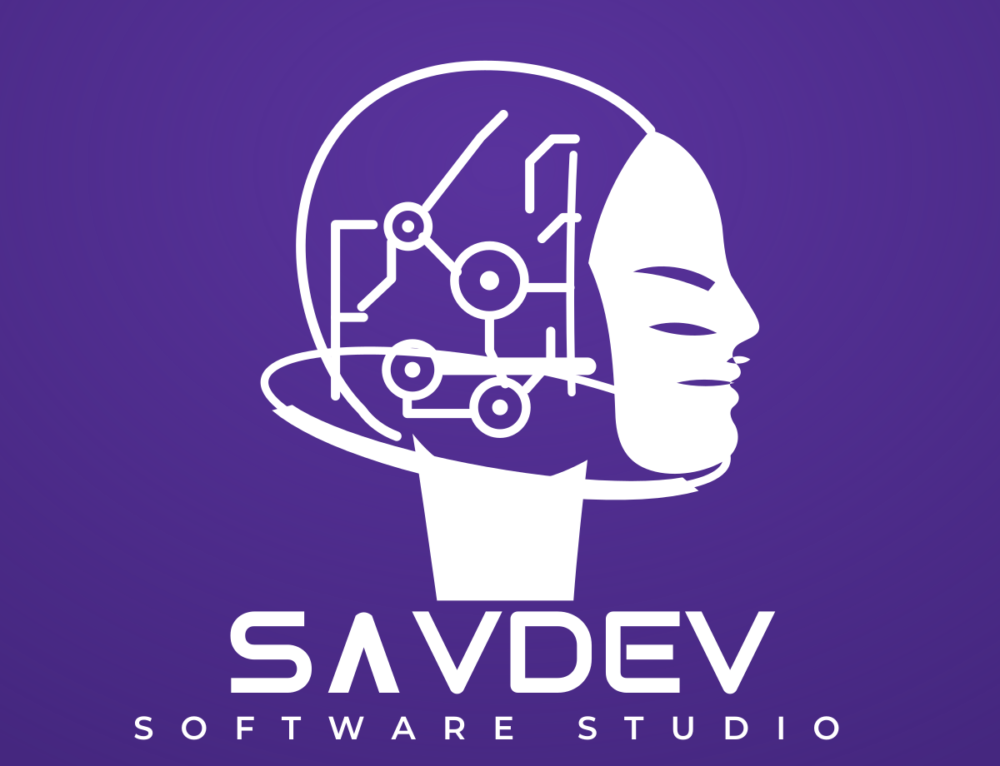

# SAVDEV Software Studio

SAVDEV Software Studio is an independent software studio founded by Iurii Savelev. Its flagship product is PsoriCare.ai.

## Projects

- **PsoriCare.ai** — a psoriasis care app: symptom tracking, food diary, skin photos, AI health coach. Live at [psoricare.ai](https://psoricare.ai) · Showcase: [Iuriisa/Psoricare.AI_Public](https://github.com/Iuriisa/Psoricare.AI_Public)

## Links

- Website: [savdev.org](https://savdev.org)
- PsoriCare.ai: [psoricare.ai](https://psoricare.ai)
- GitHub: [github.com/Iuriisa](https://github.com/Iuriisa)

## About this repository

This public repository is a showcase for SAVDEV Software Studio. It contains this README and the studio logo.
